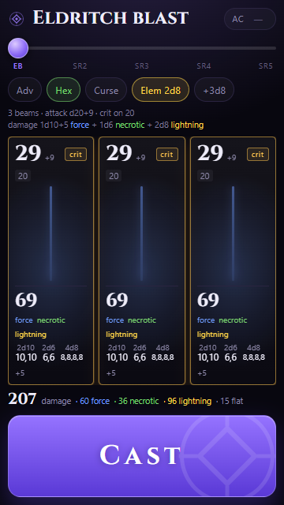

# DND-sheet

*A character sheet and a dice roller for a table, built to fit a phone screen.*

## Picking this up

```
node build.mjs                                  # src to dist, inlines the font and the data
node test\rules.test.mjs                        # the rules engine and the data
node tools\fetch-5e-data.mjs                    # refetch the surge table, the spell book and the features
powershell -ExecutionPolicy Bypass -File tools\build-apk.ps1
```

The vault note `notes/dnd-sheet-handoff.md` has the working procedure, the data pipeline and the traps.

## The characters

The name at the top of the sheet opens the list: the characters top down, the one being played marked, a cross to remove one, and a way to add one. Every character keeps its own sheet, its own spell slots, its own spell lists, its own features and its own set of pages, so a bard plays without the volley a warlock plays.

A character is added ready-made or from nothing. The ready-made ones live in `data/characters.json`, each one a record in the shape the store keeps: its pages, the features it names, its slots and its spells. The bard is the first, from the sheet of 2026-10-22: Yngwie, level 11, the college of creation, high elf, the musician and the two adept feats, the scores eight, fourteen, fourteen, ten, twelve and nineteen, eleven d8 hit dice, the slots of a level 11 bard at 4/3/3/3/2/1, the ten spells the two adept feats always prepare, and the grimoire open on the bard list. His hit points, his armour class and his skills wait to be typed on the phone.

**A character wears its own colours and its own icon.** Everything the app paints comes from a few CSS variables, so a theme is one block of them and nothing else. The icon is a small registry in the shell, the rune the app came with and an electric guitar. The record of the character names both, the head of the app paints the one it names, and the edit mode of the character page grows a gallery to change them, eight colours as swatches and fourteen icons, each one a tap away and applied live. Yngwie plays blue and red with a guitar, the warlock keeps the violet and the rune.

**A character can hold several classes.** The record keeps a list of classes, each with a level and a subclass, and the level is their sum. The edit mode of the character page carries the editor, a picker of the twelve classes, a picker of the subclasses, a stepper and a cross. The spell slots come from the multiclass table of the rules, and the pact slots from the warlock level, so a sorcerer 8 with a warlock 3 reads the slots of a caster of eight and two pact slots at level two. The save DC is one for the character, read from the class that carries the most levels.

**The initiative follows the dexterity** until you type one of your own, which then stays.

The gear at the head of the app opens the settings page, which lists the pages of the character being played. A page that is off keeps its numbers, and turning it back on brings them back. The character page is the home, so it is always on.

## What it rolls

Default: attack d20+9, critical on a natural 20, which doubles every damage die. Damage is 1d10+5 force. One tap rolls the whole volley and every die lands on screen.

| Control | Effect |
|---|---|
| Adv | the attack rolls 3d20 and keeps the highest |
| Hex | adds 1d6 necrotic |
| Curse | adds 4 flat damage, critical on 19 or 20 |
| Elem | adds 2d8 lightning, and brings the +3d8 chip out |
| +3d8 | upgrades the lightning from 2d8 to 3d8 |

The power slider swaps the spell. Eldritch blast fires 3 beams of 1d10+5 force. Scorching ray at levels 2 to 5 fires 3 to 6 beams of 2d6 fire.

The AC field is optional. Leave it empty and the app shows the damage of every beam. Set the target armor class and each beam is marked hit or miss, a miss shows no damage, and the total counts only the hits.



## The spell tab

A tracker for the character's slots and spell list, built for one hand at the table.

- **The top bar** holds the DC and the sorcery points, and two toggles: Cunning restores one warlock slot, and a sorcerer rest restores half your sorcerer level in sorcery points. The sorcery points have their own minus and plus; the DC only grows buttons in the edit mode.
- **The slot strip** runs across the top: every level from cantrips to ninth left to right, and under each one its slots stacked as pips. A filled pip means you still have it, and tapping one spends it, so tapping the last one empties the level. Tapping an empty pip resets that level up to it. A level holds up to nine slots, and the columns share the width in proportion to what they hold, so the slots widen into ellipses when a level holds more of them. At level 2 the warlock slots sit under the sorcerer ones, in teal.
- **The lightning** above a level turns one of that level's slots into sorcery points, one point for each level of the slot, so a second level slot gives two points. The warlock slots go first, they are the scarcer ones. The bolt stays dim while the points are full or the level has no slot left, and level 0 has none, since a cantrip is not a slot.
- **The arrow** under a level opens the spell list of that level.
- **The spell list** shows one card per spell with labelled fields: casting time, range, duration, components, concentration and ritual. The same fields sit in the same place on every card, so the labels line up down the list. The label at the end of the title is the source the character declares: the class that granted the spell, the feature that granted it, or nothing when nothing is declared. It is red for the sorcerer, blue for the warlock and the hexblade, half blue half red for the Izzet engineer and green for the elf. The grimoire opens with a SOURCE row to declare it, and the page of a spell carries the same row to change it later. Tap a card for the full page, tables and the Using a Higher-Level Spell Slot section included, and hold and drag a card to reorder the list. The plus at the head of the list opens the grimoire for that level.
- **The grimoire** is where new spells come from. It holds every spell the classes can learn, 397 of them, and each one carries the classes that can learn it. Under every spell sits a button for each of those classes, grey or green, and a tap turns that class on for the whole list. With every class grey the list shows everything, and with one class green it shows only the spells of that class. The classes are the eight of the 2024 handbook, plus the hexblade, the izzet engineer and the elf, the three his own sheet names.
- **The toggle** at the head of the grimoire keeps it on the level you are looking at, and turns it off to show the spells of every level at once. Tapping a spell opens its full page and the close brings the grimoire back. A plus learns a spell and a check unlearns it.
- **A spell with a trigger** keeps it for the full page and not for the card: Shield reads "Reaction" on the card and "1 reaction, which you take when you are hit by an attack roll or targeted by the Magic Missile spell" on the page, and the smites do the same.
- **The text of a spell is marked up.** The damage stands in red, "8d6 Fire damage" as one piece, the saving throws in blue, and the conditions carry a dotted line, because tapping one opens the reference to conditions and diseases on 5e.tools.
- **The sheet of a spell** holds the level, the casting time, the range, the duration, the components, the concentration, the ritual and the source in two columns of a readable size, and the casting time takes the whole width when it carries a trigger.
- **The wrench** in the top right turns on the edit mode, where each level grows minus and plus buttons for the maximum number of slots, and the sorcerer level can be changed. A level with no slots is dimmed, which is how level 5 and the levels above it start out until you unlock them.

The list is seeded from the character's own sheet in `data/spell-sheet.csv`, one line per spell with the class that granted it. Everything else comes from the grimoire.

## The character tab

The front of the character sheet, for the numbers you look up mid turn.

- **The top row** holds the armor class, the initiative modifier and the level, all three editable and read in the middle. The level gives the proficiency bonus, so raising it moves every saving throw and every skill at once.
- **The hit points** sit under them, the current over the maximum. The minus takes a point, the plus gives one back, and the field itself takes a number, so a wound of seventeen goes in as seventeen.
- **The abilities** are six tiles: the score, with the modifier under it. Type a score and everything that leans on it moves. The saving throw of the ability sits right under its own tile.
- **The saving throws and the skills** carry a marker and a modifier. An empty dot means the character has nothing in it, a gold dot means proficient, and a dot with a ring around it means expertise, which takes the proficiency twice. In the edit mode a tap cycles a row from none to proficient to expertise and back.
- **The derived line** under the abilities reads the proficiency bonus, the spell attack, the save DC and the passive perception, all of them computed from the scores above.
- **The hit dice** sit under the hit points, one icon per die, drawn in the shape of the die itself: a d6 is a square, a d8 a diamond, a d10 a kite, a d12 a pentagon and a d20 a hexagon. Tapping one spends it and tapping it again gives it back, because some effects spend a die without a roll, and the points are rolled by hand. A long rest gives every die back. The wrench turns the box into a picker for how many dice of each type, from d12 to d6.
- **The features** have their own tab, the one below. The rests here still restore them, and the note says which ones came back.
- **The short rest** gives back the features marked as recovering on a short rest, and nothing else: the warlock spell slots and one use of the hexblade curse. The **long rest** gives back the hit points, every spell slot, the sorcery points and every use of every feature.
- **The rewind** undoes the last change of any kind: a point of hit points, a use of a feature, or a whole rest. Hit it after a rest you did not mean, and the hit points, the slots and the features come back as they were.
- **The wrench** in the top right turns on the edit mode, where the proficiencies move and the name of the character can be set. Outside it a stray tap never changes a modifier.

The sheet starts from what the rest of the app already assumes: charisma 20 and a level 9, which give the attack of +9 and the save DC of 17, with constitution and charisma proficient in the saving throws. The other numbers wait for the player.

## The features tab

The list of what the character can do, and what is left of it.

- **The active features** are the ones with uses: innate sorcery, metamagic, tides of chaos, sorcerous rest, bend luck, magical cunning, the hexblade curse and the two elven lineages. Each row shows the source, the uses left and when they come back, "2 / long" meaning two uses that a long rest gives back. Tapping the count spends a use, and at zero it gives one back. Bend luck costs a sorcery point rather than a use, so its count spends a point from the spell tab.
- **The passive features** are the ones that always work: sorcery incarnate, the three warlock invocations, the wild surge, hex warrior, trance, fey ancestry and elven accuracy.
- **Tapping a name** opens the full description, the text 5e.tools holds, with the action and the duration.
- **The wrench** turns on the edit mode of the tab. The hidden rows come back, the warlock spell slots and the three the spell tab already tracks, metamagic, sorcerous rest and magical cunning, and the eye on a row hides it again. The count becomes a field there, so the number of uses left can be set, and so can the maximum, which is what a rest gives back. Each row grows a red button that removes the feature, after it asks.
- **The plus** at the head of the section opens a form that asks for the name and the recovery type: short rest, long rest, special or passive. A passive feature has no uses at all.
- **The cards can be dragged** to reorder them, the way the spell list does. A press that turns into a move carries the card, a press that ends at once is a tap.
- **Spending a sorcery point** leaves a mark: a gold toast says how many points are left, and it lingers for three seconds.

The list is Mandal's own table of 2026-10-22: the short text, the uses and the recovery are his words, and the long text is pulled from 5e.tools by `tools/fetch-5e-data.mjs` into `data/features.json`. The file holds the features of both characters, the eighteen the app's own character starts with and the twelve the bard brings, and a feature that belongs to one of them says so. A character that names its features keeps exactly those, and once it exists its own list is the truth.

## The wild magic surge

The surge lives in the spell tab, under a Wild label at the end of the top bar, right of the sorcerer rest. It opens a popup with the old interface: the d100 in the middle, the range it landed on, the effect and the dice it names. Tap the number or the button to roll again, and the last result stays on the phone. The table is the one from the 2024 Player's Handbook, the same one 5e.tools serves under its XPHB source.

The table is never typed by hand. `tools/fetch-5e-data.mjs` pulls it out of the 5e.tools class data, parses it into `data/wild-magic-surge-xphb.json`, and refuses to write a table that does not cover 1 to 100 exactly once. The build inlines that JSON into the page, and the test suite checks the inlined copy against the file.

The same script pulls the spell book: every spell the classes can learn, plus the spells on the character's sheet, with their casting time, range, duration, components, full text and the classes that can learn each one, into `data/spellbook.json`. The entries keep their structure, so the tables and the Using a Higher-Level Spell Slot sections survive, and the casting time keeps the trigger a reaction waits for.

```
node tools/fetch-5e-data.mjs
```

The 2014 table is a different file with the same shape, so swapping editions means pointing the build at it.

## Run it

`dist/index.html` is the whole app: one file, no server, no network, 761 KB with the font, the spell book and the features inlined. Copy it to the phone, open it in Chrome, then Add to home screen for a full screen launcher.

To serve it to a phone on the same wifi:

```
python -m http.server 8123 --directory dist
```

## The Android app

The same page ships as an installed app, with no browser and no server. The APK lives at `dist/dnd-sheet.apk` and carries the page in its assets, so it works offline and keeps its state between launches.

```
tools\install-android-sdk.ps1   # once: command line tools, android-34, build-tools
tools\build-apk.ps1             # resources, dex, sign
```

`app/` holds the shell: one activity, a WebView on `file:///android_asset/index.html`, portrait locked, dark background, vibration allowed so the roll still buzzes.

The signing key is `keys/volley.keystore` and it is in git on purpose: the phone only accepts an update signed with the same key, so losing it means reinstalling from scratch.

To put it on the phone, serve the folder and open the file there:

```
python -m http.server 8123 --directory dist
```

Then on the phone open `http://<this machine>:8123/dnd-sheet.apk`. Chrome says the file can harm the device, tap Download anyway, and allow installs from that source when it asks. The DND-sheet icon lands on the home screen and opens full screen, offline.

## Build

`src/index.html` is the source. The only difference from `dist/index.html` is that the display font is inlined as base64.

```
node build.mjs
node test/rules.test.mjs
```

The rules engine lives in a `<script id="rules">` block that touches no DOM, and the character sheet rules live in a `<script id="sheet-rules">` block of the same kind. The test suite extracts both and checks the maths: crit thresholds, doubled dice, each toggle, each power, the tally against an AC, the ability modifiers, the saving throws, the skills and the hit point tracker.

## Choices worth knowing

- Minor element and its plus chip are one choice, not two layers: 2d8 lightning, or 3d8 once the chip is on. The `EXTRAS` table in the rules block is the single place to change that.
- Scorching ray carries no flat bonus, only Eldritch blast does. The `flat` field of each power says so.
- Advantage rolls 3d20 and keeps the highest, as specified, where the rules book rolls 2.
- A critical doubles the dice of every damage group, of any type, and never the flat bonuses.
- The concentration flag comes from the duration in the 2024 data, not from a field of its own. The fetcher reads both, so a spell that holds concentration says so.
- Turning a slot into sorcery points is one rule, `Rules.convertSlot`, so the test suite can check it without a browser.
