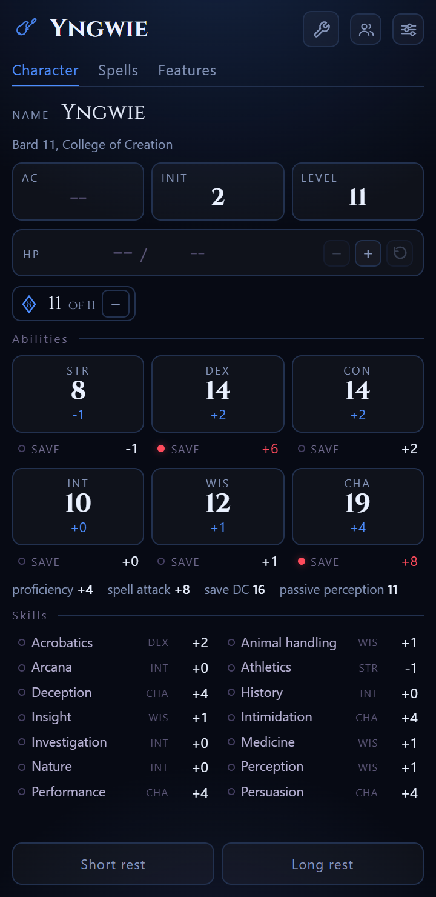

# custom-sheet

*Open source character sheet tracker designed for agents. The goal: character tracker fully customizable via natural language.*

A character sheet and a dice roller for one table, on a phone. The sheet is a
single web page, and the same page ships as an Android app that works with no
network at all.

The rules text comes from the SRD. The characters are yours. The shape of the
app is a set of pages, and any of them can be added, taken away or rewritten,
by hand or by an agent.



## What is in the app

**The character.** The numbers you look up mid turn: the armour class, the
initiative, the level, the hit points, the six abilities, the saving throws,
the skills, the hit dice and the rests. A short rest gives back the features
that come back on a short rest and nothing else, a long rest gives back
everything, and the rewind takes back a rest you did not mean.

**The spells.** The slots, counted level by level, and the list of the spells,
each card labelled with the class or the feature that granted it. A tap spends
a slot, the lightning above a level turns a slot into sorcery points, and the
grimoire holds every spell the classes can learn with the classes that can
learn each one.

**The features.** What the character can do, and what is left of it. The
active features carry their uses and say when they come back, the passive ones
always work, and every one opens its full text.

**The summons.** The creatures you have called to the table. The tab is off by default and the settings turn it on. A summon carries a name you can change, the armour class, the hit points, the attacks with their bonus and their damage, and the slot that paid for it. The numbers the book writes as words are worked out with that slot, so the armour class of a spirit, its hit points, the damage of its attacks and the number of attacks of a multiattack follow the level it was called at, and a creature that comes in forms, the celestial spirit is an avenger or a defender, carries the form it took. A spell is a summon when it names a creature, so the conjure spells of the 2024 handbook, which bring a pack and not a creature with a block, are not in it. The stat blocks come from the same place as the spell book, and the app carries the ones it names. The machine that serves the app holds the rest of the bestiary, so a creature you need and the app does not have can be fetched from there.

**The volley.** The roll: the attack, the damage, the advantage, the hex, the
curse and the elemental. Give it an armour class and it marks the hits and
the misses.

**The settings.** The pages that are on, the files that have arrived, the
exchange, the shelf, the credits and the update.

## The characters

A device with no character opens on the ways in: a character from a class, a
character from nothing, a file someone sent, a link, or one of the characters
published on the shelf. Nothing ships inside the app, so the first screen is
a way in rather than a sheet.

The characters published on the shelf are the examples: Wendy the sorcerer
and Yngwie the bard, one file each in `characters/`, named after the
character.

The others are built from a class, a level and a subclass, and the app fills in
what it can: the features the class grants, the saving throws, the spell slots
and the hit dice. The rest waits for you or for the agent: the scores, the hit
points, the armour class and the skills.

**A character wears its own colours and its own icon.** The colours are a
block of CSS variables, so a theme is that block and nothing else, and there
are eight of them. The icon is a small registry of fourteen, from the rune the
app came with to an electric guitar.

**A character can hold several classes.** The record keeps a list of them, each
with a level and a subclass, and the level is their sum. The spell slots come
from the multiclass table of the rules and the pact slots from the warlock
level. The save DC is one for the character, read from the class that carries
the most levels.

**The hit dice come from the classes.** A sorcerer rolls a d6 and a warlock a
d8, so the dice of a character are the dice of its classes, one counter for
each kind of die.

## The exchange

A character is a package: JSON, with a name, a kind and a version. There are
three ways for one to travel, and none of them asks you to type a secret.

**As a file.** The app writes the package and the phone offers it to send, or
the explorer of the phone opens one that comes back.

**As a link.** The app packs the character into the link itself, squeezed and
encoded, and the other end reads it out of the link. The character rides in
the fragment of the link, and a fragment never reaches a server, so nothing of
it is left behind anywhere. It is the shortest way to hand a character to the
player across the table.

**The shelf.** A folder in this repository, read by every app with no secret
at all. Drop a character in `characters/` and commit it, and every app brings
it in with one tap. Open a branch and the branch is a shelf of your own, and
the app lists the branches too. A character on the shelf has an address on
GitHub, and the app brings one in from that address as well, so a character
can be found by name and address rather than by a link in a message.

The shelf also writes back. Connect the app to GitHub once, and the character
being played goes onto the shelf with a tap, one file per character, on the
branch you name. The connection is a token, and the app never asks you to
type one: on a phone the app asks GitHub for a code, you approve it in the
browser, and the token lands by itself. A page of a browser cannot ask
GitHub for a sign in, so on a desktop you paste a token instead, and a paste
is accurate where a typing is not.

The shared shelf is this repository, and it holds the characters of the
project. A shelf of your own is a repository of your own, made by the app or
forked from this one, and the app points at whichever you name.

## Install it

### On a phone

The build is an APK, and it carries the page in its assets, so it works
offline and keeps its characters between launches.

```
https://raw.githubusercontent.com/NewbornAI/custom-sheet/main/dist/custom-sheet.apk
```

Open that on the phone, allow the install when the phone asks, and the icon
lands on the home screen. The signing key is not in this repository, on
purpose, so an APK that you build yourself cannot update that one in place:
uninstall the old one first, then install yours.

### On a desktop

The page is one file and the data sits beside it, so serve the folder and open
the page.

```
node tools/serve.mjs 8123
```

Then open `http://127.0.0.1:8123/index.html`. The book, the library of
features, the classes and the bestiary are read when a page asks for them, and
the settings page says which of them have arrived. That server also holds the
whole bestiary, and the summons tab fetches a creature from it when the app
does not carry the one you need.

## Build it

```
node build.mjs                                  # src to dist, the font and the data inlined
node test/rules.test.mjs                        # the rules engine and the data
node test/github.test.mjs                       # the sign in and the calls to GitHub
node test/address.test.mjs                      # the address of a file on GitHub
node tools/fetch-5e-data.mjs                    # refetch the data from 5e.tools
node tools/serve.mjs                              # serve the build and the whole bestiary
powershell -ExecutionPolicy Bypass -File tools/build-apk.ps1
```

The Android shell needs the command line tools, android-34 and build-tools;
`tools/install-android-sdk.ps1` puts them in place.

## The data

The text of the rules is the System Reference Document, and it is fetched into
the files under `data/`.

| File | What it holds |
|---|---|
| `classes.json` | the twelve classes of the 2024 handbook and their 123 archetypes, the newest printing of each |
| `features.json` | 1017 features of those classes and archetypes, with their text |
| `spellbook.json` | 397 spells, with the classes that can learn each one |
| `bestiary.json` | the stat blocks the spells and the features name, with their actions |
| `wild-magic-surge-xphb.json` | the surge table of the 2024 handbook |
| `spell-sheet.csv` | the spells of the sheet of the table, one line each |

`tools/fetch-5e-data.mjs` pulls them from 5e.tools, and the build writes the
data files beside the page so the page itself stays small.

## For agents

The README is the human entry point. `AGENTS.md` is the agent one: where the
seams are, how a page is written, how the data is read, and the shape of the
package.

Three things an agent leans on:

- **The library.** The data holds every class feature of the twelve classes
  and their archetypes. `plugFeature(key)` drops one into the character being
  played, and the feature page picks it up.
- **The pages.** A page is a file of its own, and the settings page turns the
  pages on and off per character. A page that comes in a package brings its
  own markup, its own style and its own rules.
- **The package.** A character leaves as JSON and comes back the same way, so
  an agent can write a character, a page, or both, and hand them over as one
  file.

## The licence

The code is under the MIT licence, in `LICENSE`.

The text of the rules in the data files is under the Creative Commons
Attribution 4.0 International Licence, and `NOTICE` says where it came from,
names the licence and links it. The data was taken from 5e.tools and laid out
by this project.

Dungeons & Dragons, D&D and the D20 logo are trademarks of Wizards of the
Coast LLC. This project is not affiliated with, endorsed by or sponsored by
Wizards of the Coast. The font Cinzel is under the SIL Open Font Licence 1.1.

## The layout

```
src/index.html       the shell, the styles and the two rules blocks
src/shell.js         the registry, the store, the overlay, the packages, the shelf
src/github.js        the sign in and the calls to GitHub
src/pages/*.js       one file per page
data/*.json          the rules data
app/                 the Android shell that wraps the same page
tools/               the build, the data fetch, the server, the icon maker
test/rules.test.mjs  the rules engine and the data
characters/          the shelf: one package per file
```
